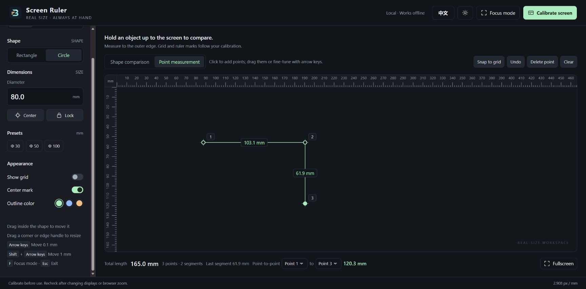

# 屏幕尺子 · Screen Ruler

一个可以直接在浏览器中打开的屏幕尺子。校准后，把物品放在屏幕前，用可拖动方框、圆形或多个标记点对比实际尺寸。

[下载屏幕尺子.html](https://github.com/beason409/screen-ruler/raw/refs/heads/main/%E5%B1%8F%E5%B9%95%E5%B0%BA%E5%AD%90.html) · [详细使用说明与硬币规格来源](使用说明.txt)



## 使用

1. 下载上方的 `屏幕尺子.html`，或下载仓库。
2. 用 Edge、Chrome 或 Firefox 打开 `屏幕尺子.html`。单个 HTML 文件即可离线运行，无需安装或启动服务器。
3. 点击“校准屏幕”，选择一种校准方式并保存。
4. 使用“形状对比”或“定点测量”；形状可选方框或圆形。
5. 页头点击“English”切换英文，点击“中文”切回中文；语言选择保存在当前浏览器。

## 功能

- **中英文切换**：测量工具、校准说明、硬币版本、提示和读数均支持中英文，切换时保留当前尺寸、校准和点位。
- **方框对比**：拖动位置、拖动八个角点或边点改尺寸，也可以直接输入宽高；支持正方形、旋转、居中和锁定。
- **圆形对比**：输入直径，或拖动圆周的四个控制点调整直径，始终保持正圆。读数中的 `Φ` 表示直径；方框和圆形分别记住尺寸，也可在全屏工具条中切换。
- **四种校准**：屏幕尺寸与分辨率、硬币、银行卡、直尺或已知长度。
- **显示器规格校准**：可选常见屏幕尺寸，或选择“自填规格”填写已知信息；还可选填可视对角线、画面宽高、宽高比、水平/垂直点距和像素密度。屏幕尺寸预设支持英寸、厘米、毫米显示；补充长度支持毫米、厘米、英寸自动换算，密度支持 px/mm、px/cm、PPI。
- **硬币参照**：内置人民币、美元和欧元共 10 种规格，人民币 1 元区分新旧版本。
- **定点测量**：连续点击添加最多 50 个点，显示相邻段距离、总长度和任意两点的直线距离；支持拖点、键盘微调、删除、撤销和清空。
- **吸附网格**：在定点测量中开启后，新建和拖动的点会吸附到 5 mm 网格交点。开启时已有点位保持原位，隐藏网格会自动关闭吸附。
- **测量区全屏**：把画布铺满屏幕，使用可收起的浮动控制条切换方框或点测、开关吸附和退出全屏，保持校准后的真实比例。
- **显示设置**：毫米、厘米、英寸，明暗背景，网格，边框颜色和专注模式。

方向键移动选中的方框或点位 `0.1 mm`，按住 `Shift` 移动 `1 mm`。点测吸附开启时，方向键按 `5 mm` 网格步进，`Shift` 按 `10 mm` 步进。`F` 切换专注模式，`Esc` 退出专注模式。

## 校准与数据

屏幕尺寸与分辨率方式不需要参照物，依据显示器规格估算比例。填写当前输出分辨率与已知尺寸即可；常见屏幕尺寸和所有补充规格均选填。选择“自填规格”可不采用预设，用画面宽高、可视对角线或其他可用规格计算。画面宽或高只填一项时，另一项按宽高比推算；尺寸与点距请按当前屏幕横竖方向填写。

计算依次优先采用画面宽高、点距与原生分辨率、像素密度与原生分辨率、可视对角线、常见屏幕尺寸。其余已填数据用于交叉核对，相差超过 1% 时显示来源和差异；当前输出与采用的画面宽高比不一致超过 1% 时，需要核对后再保存。多填规格有助于发现不一致，计算不会把几种来源直接平均。

点距和面板像素密度对应原生像素。默认“暂不清楚”时，这两项只记录、不参与计算；可以确认“当前输出就是面板原生分辨率”，或另填原生分辨率。例如原生 2560 × 1440 的面板切换为 1920 × 1080 输出时，应保留原生值，避免误算物理尺寸。亮度和面板类型不参与尺寸换算。

例如规格中的画面 `596.736 × 335.664 mm`、点距 `0.2331 mm` 与原生 `2560 × 1440` 可相互核对；也可直接将可视对角线填为 `68.5 cm`。27 英寸预设与这些规格的正常取整差异不会触发 1% 提示。校准时显示实际采用的来源，并保存填写值与单位。需要更精确时，请用硬币、银行卡或直尺亲自对齐后校准。

更换显示器，或改变系统显示缩放、浏览器缩放后，需要重新确认校准。参数相同的两块显示器之间切换可能无法自动识别。

校准与设置仅保存在当前浏览器的本地存储中，不上传数据。测量点保留在本次页面中，切换测量模式不会丢失，刷新后清空。浏览器禁止本地存储时，本次打开仍可使用，设置无法跨次保存。

尺寸不会为了适应窗口自动缩小。可完整对比的物品尺寸受屏幕实际大小限制。

## 开发与验证

日常使用不需要 Node.js；以下命令仅用于修改源码后的构建与检查，不依赖第三方包。

```sh
node build-offline.cjs
node check.cjs
node verify.cjs
node verify-points.cjs
```

`build-offline.cjs` 把 `i18n-source.js` 和 `point-measurement-source.js` 内联到 `屏幕尺子.html`，保持这个入口可独立离线使用。

已提供脚本语法、DOM 引用、无外部依赖、校准与网格吸附行为检查。定点测量的点击、拖动、距离换算、撤销、清空、模式切换及校准比例同步已进行浏览器实测。

主要文件：

| 文件 | 用途 |
| --- | --- |
| `屏幕尺子.html` | 可独立打开的完整应用 |
| `point-measurement-source.js` | 定点测量模块源码 |
| `i18n-source.js` | 中英文词典与语言切换源码 |
| `build-offline.cjs` | 更新 HTML 内联模块 |
| `check.cjs` / `verify.cjs` / `verify-points.cjs` | 静态检查、核心行为与定点测量检查 |
| `使用说明.txt` | 操作说明、校准公式与硬币规格来源 |

## English

Screen Ruler is a self-contained browser tool for comparing real objects against a draggable rectangle or circle, or measuring distances between marked points. Open `屏幕尺子.html` locally; no installation, server, network connection, or external assets are required.

Use **English / 中文** in the header to switch languages. Your preference is remembered without changing calibration, dimensions, or marked points.

Calibrate with display dimensions and resolution, a coin, a bank card, or a known length. Optional display specifications include the visible diagonal, active width and height, aspect ratio, pixel pitch, and pixel density, with metric and imperial unit conversion. Pitch and panel density require a confirmed native resolution. The selected source is shown and other supplied specifications are cross-checked. Display-parameter calibration is an estimate; use a physical reference for greater accuracy, and recalibrate after changing displays or zoom. Settings stay in browser-local storage, and point positions are cleared when the page reloads.
